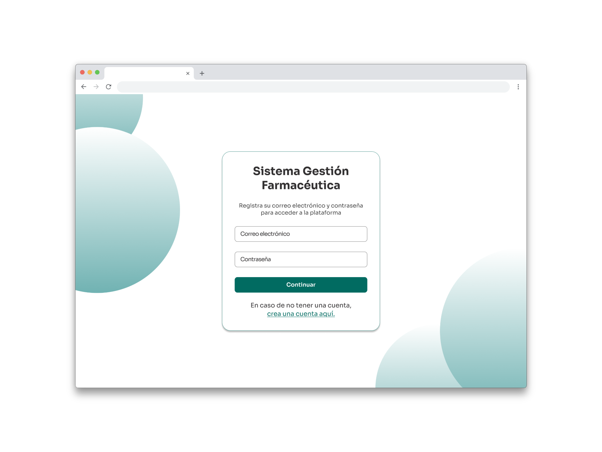
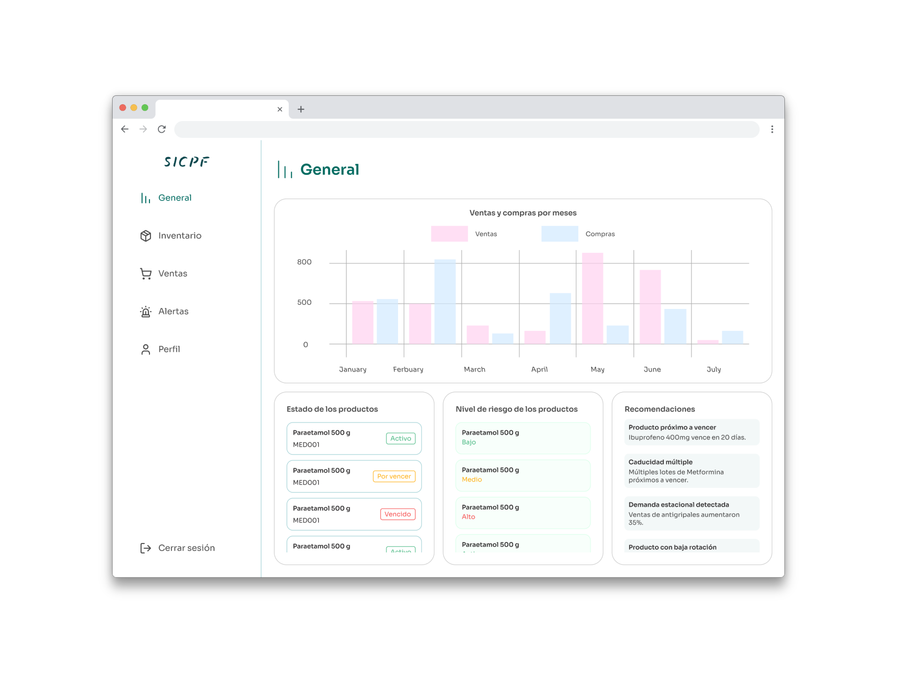
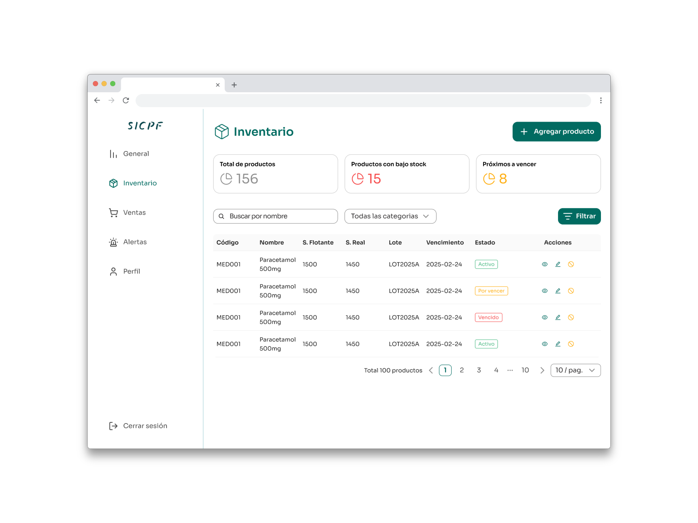
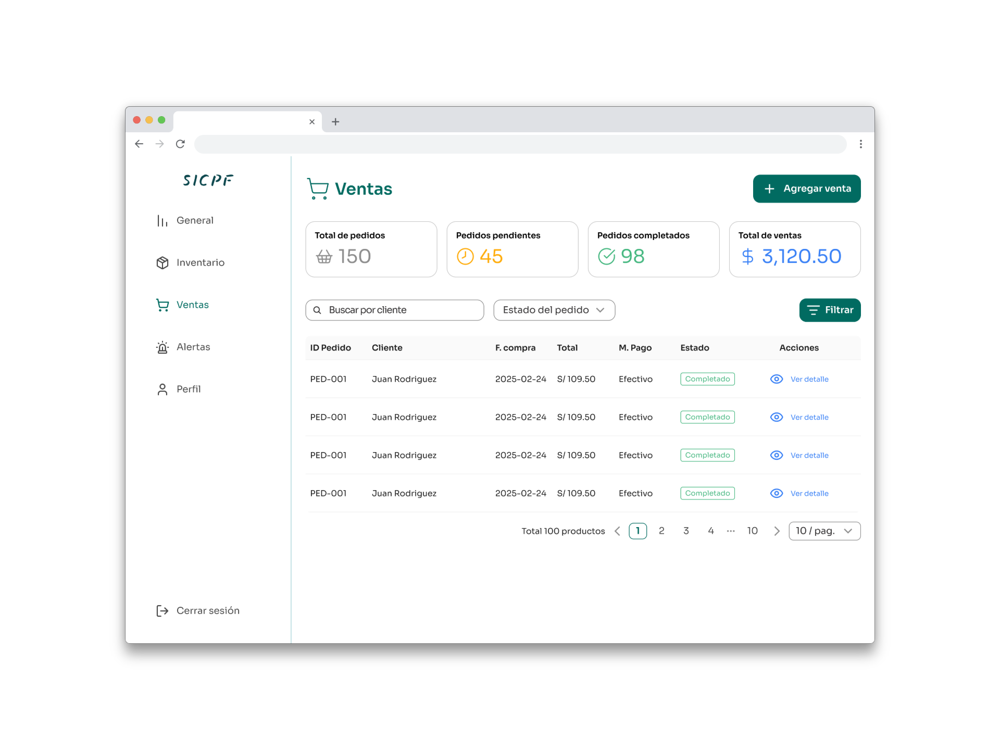
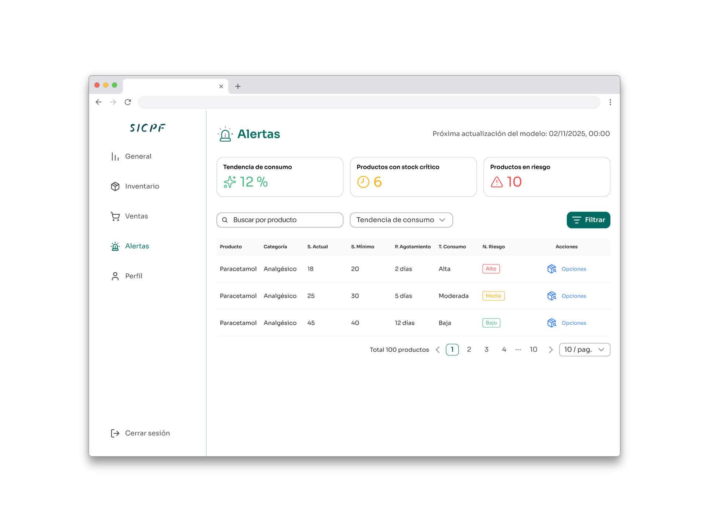
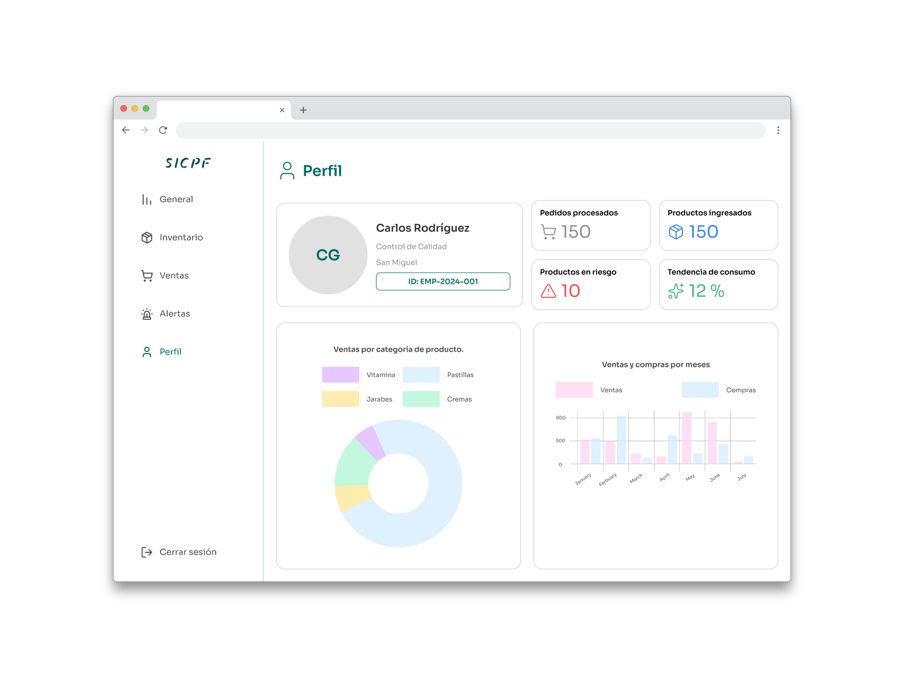

# SICPF
SICPF es un sistema inteligente que a partir de modelos de inteligencia artificial, automatiza la gestión de inventario de productos, mediante el análisis del histórico de ventas y los patrones de consumo de los productos para predecir la demanda de productos entre otros. Este proyecto nace por el hecho de facilitar la productividad de los procesos internos de la empresa de venta de productos farmacéuticos Boticas Perú.

**Integrantes:**
- Cisneros Culaca, David
- Pardave Jara, Asthri
- Patricio Julca, Vilberto
- Reyes Fabian, Zamir

## Diseño de la UI

### Inicio de sesión.

### Dashboard: Sección General

### Dashboard: Sección Inventario

### Dashboard: Sección Ventas

### Dashboard: Sección Alertas

### Dashboard: Sección Perfil

Enlace del diseño: [SICPF](https://www.figma.com/design/mNmJqpgocnQnuPpo4uMvuk/-WEB----SICPF?node-id=1-2&t=7MgNqglLGPRCt1qh-1)