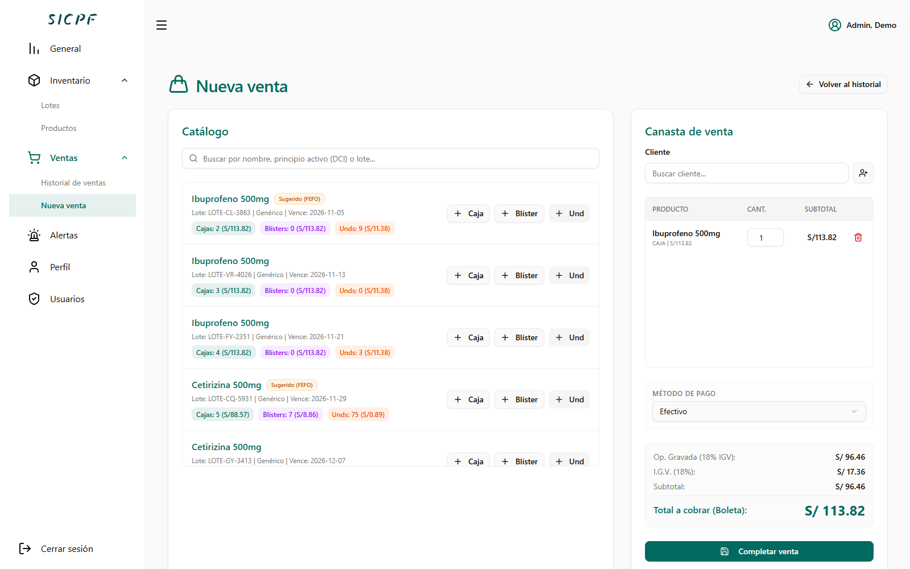

# SICPF

### Sistema de Información para el Control de Productos Farmacéuticos

Aplicación web para gestionar el catálogo, el inventario por lotes y las ventas de una farmacia. Centraliza existencias, fechas de vencimiento, alertas y actividad comercial en una interfaz con acceso por roles.

SICPF es un proyecto independiente y adaptable a distintas farmacias. La identidad de cada negocio se configura por instalación, sin vinculación con una empresa específica.

- [Funcionalidades](#funcionalidades)
- [Capturas](#capturas-de-la-aplicación)
- [Stack](#stack-tecnológico)
- [Instalación](#instalación-local)
- [Estructura](#estructura-del-proyecto)

## Funcionalidades

| Módulo | Capacidades |
| --- | --- |
| Panel general | Gráfico de ventas, productos próximos a vencer, niveles de riesgo y recomendaciones. |
| Catálogo | Productos, categorías, marcas, formas farmacéuticas y presentaciones por caja, blíster o unidad. |
| Inventario | Existencias por lote, vencimientos, stock mínimo, búsqueda, filtros y activación o desactivación de registros. |
| Ventas | Registro de ventas, clientes, métodos de pago, sede, historial, detalle e impresión de tickets. |
| Alertas | Detección mediante reglas de stock bajo, stock crítico, vencimientos y quiebre estimado; revisión y descarte de alertas. |
| Usuarios y acceso | Autenticación JWT, permisos por rol, administración de usuarios, perfil y cambio de contraseña. |
| Administración | Configuración del negocio, catálogos auxiliares y registros de auditoría desde el backend. |

El backend incluye modelos para predicciones y recomendaciones. Los datos de demostración pueden contener predicciones simuladas; el repositorio no incluye una canalización de entrenamiento de modelos de aprendizaje automático.

## Capturas de la aplicación

Capturas de la aplicación ejecutada localmente con datos ficticios de demostración.

### Panel general


### Inventario por lotes


### Historial de ventas


### Nueva venta



### Alertas


## Stack tecnológico

| Capa                           | Tecnologías                                                                      |
| ------------------------------ | -------------------------------------------------------------------- |
| Interfaz                       | React 19, TypeScript 5.9, Vite 7 y React Router 7.                   |
| Estilos y componentes          | Tailwind CSS 4, Radix UI, Lucide y componentes basados en shadcn/ui.             |
| Estado y formularios           | Zustand, React Hook Form y Zod.                                      |
| Tablas y gráficos              | TanStack Table y Chart.js con react-chartjs-2.                                   |
| API                            | Python, Django 5.2 y Django REST Framework.                       |
| Autenticación                  | Simple JWT, grupos y permisos de Django.                 |
| Base de datos                     | SQLite para desarrollo local y PostgreSQL para producción.           |
| Administración y documentación | Django Admin con Jazzmin y OpenAPI/Swagger mediante drf-spectacular.    |
| Pruebas                        | Django TestCase, Jest y Testing Library.                 |
| Despliegue                     | Configuración para Render, Gunicorn y WhiteNoise.     |

## Instalación local

### Requisitos

- Python 3.10 o superior y pip.
- Node.js 20.19+ o 22.12+ y npm.
- Git.

Los comandos siguientes parten de la raíz del repositorio y utilizan PowerShell en Windows.

### 1. Backend

```powershell
cd source/backend
python -m venv .venv
.\.venv\Scripts\Activate.ps1
pip install -r requirements.txt
python manage.py migrate
python manage.py createsuperuser
python manage.py runserver
```

El backend estará disponible en `http://127.0.0.1:8000`. En macOS o Linux, active el entorno con `source .venv/bin/activate`.

Para desarrollo local, un archivo `source/backend/.env` puede contener:

```dotenv
DEBUG=True
SECRET_KEY=reemplazar-por-una-clave-local
ALLOWED_HOSTS=localhost,127.0.0.1
CORS_ALLOWED_ORIGINS=http://localhost:5173,http://127.0.0.1:5173
```

Sin `DATABASE_URL`, Django utiliza SQLite. Para PostgreSQL, configure esa variable con la cadena de conexión de su propia instalación. No incluya credenciales ni archivos `.env` en Git.

### 2. Frontend

En otra terminal, desde la raíz del repositorio:

```powershell
cd source/frontend
npm i
```

Cree `source/frontend/.env` y coloque el siguiente texto:

```dotenv
VITE_API_URL=http://127.0.0.1:8000/api
```

Inicie la interfaz:

```powershell
npm run dev
```

Abra `http://localhost:5173` e ingrese con el usuario creado en Django. La configuración de producción de referencia se encuentra en `source/frontend/.env.production.example`; sustituya la URL por la de su backend.

### 3. Configurar el negocio

Ingrese a `http://127.0.0.1:8000/admin/` y configure el registro activo en **Configuración del Negocio**. Registre nombre comercial, razón social, RUC y dirección; opcionalmente, agregue logo, contacto, mensajes y URL de consulta propios.

Sin esos cuatro campos completos, o si no se puede obtener la configuración, la impresión usa un **ticket de demostración sin validez tributaria**, sin identificación empresarial ni QR tributario. Completar la configuración no implementa el envío ni la autorización de comprobantes ante SUNAT.

En instalaciones existentes, las migraciones conservan los datos guardados: revise y limpie cualquier identidad empresarial anterior desde el administrador. Consulte la [guía del backend](source/backend/README.md) para más detalles.

### Datos de demostración opcionales

El script `source/backend/populate_db.py` genera productos, lotes, clientes y ventas ficticios. **Elimina datos existentes antes de poblar la base**; ejecútelo únicamente sobre una base de pruebas desechable. Para asociar el administrador a los datos generados, el script busca el nombre de usuario `admin@example.com`.

## Estructura del proyecto

```text
sicpf-demo/
├── docs/
│   ├── db/                  # Documentación y diseño de la base de datos
│   └── screens/             # Capturas de la aplicación
├── source/
│   ├── backend/
│   │   ├── api/             # Modelos, API, servicios, permisos y pruebas
│   │   ├── sicpf_core/      # Configuración de Django y rutas principales
│   │   ├── manage.py
│   │   ├── populate_db.py   # Generación de datos de prueba
│   │   └── requirements.txt
│   └── frontend/
│       ├── public/          # Recursos estáticos
│       └── src/
│           ├── components/  # Componentes, tablas, formularios y vistas
│           ├── features/    # API, estado y tipos por módulo funcional
│           ├── pages/       # Acceso, layout y página de error
│           ├── router/      # Rutas y protección de acceso
│           └── utils/       # Utilidades de tickets y códigos QR
├── render.yaml              # Plantilla de despliegue
└── LICENSE
```

La interfaz consume una API REST bajo `/api/`. El backend concentra las reglas de negocio y la persistencia; el frontend organiza las llamadas y el estado por módulo funcional.

## Verificación

Desde `source/backend`, con el entorno virtual activo:

```powershell
python manage.py makemigrations --check --dry-run
python manage.py test api
```

Desde `source/frontend`:

```powershell
npm test -- --runInBand
npm run build
```

Las pruebas deben apuntar a una configuración de desarrollo o pruebas. Para una comprobación manual, recorra el panel, inventario, registro e historial de ventas, alertas e impresión de tickets.

## Documentación y despliegue

- [Guía del backend](source/backend/README.md).
- [Guía del frontend](source/frontend/README.md).
- [Documentación técnica de la API](docs/README.md).
- [Documentación de la base de datos](docs/db/README.md).
- Swagger local: `http://127.0.0.1:8000/api/docs/`.
- Esquema OpenAPI: `http://127.0.0.1:8000/api/schema/`.

`render.yaml` contiene una plantilla para publicar frontend y backend en Render. Configure sus propias URLs, orígenes permitidos, clave secreta y conexión PostgreSQL antes del despliegue.

## Licencia

Distribuido bajo la [licencia Apache 2.0](LICENSE).
