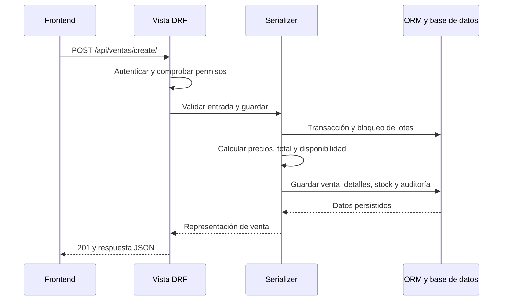

# Documentación técnica de SICPF

SICPF es una aplicación independiente de gestión farmacéutica. Esta documentación describe el código actual; la instalación se explica en el [README principal](../README.md), la [guía del backend](../source/backend/README.md) y la [guía del frontend](../source/frontend/README.md).

## Índice

- [Esquema y reglas de datos](db/README.md).
- [Diagrama y diccionario de datos](db/design.md).
- Capturas actuales: [general](screens/general.png), [inventario](screens/inventario.png), [ventas](screens/ventas.png), [nueva venta](screens/nueva-venta.png) y [alertas](screens/alertas.png). Se tomaron con datos ficticios.

## Arquitectura

El frontend utiliza React, TypeScript y Vite, con módulos funcionales para llamadas HTTP y estado en Zustand. Consume una API REST implementada con Django y Django REST Framework. SQLite es la opción local; PostgreSQL se configura mediante `DATABASE_URL`.

| Componente | Responsabilidad real |
| --- | --- |
| [Rutas principales](../source/backend/sicpf_core/urls.py) y [rutas de negocio](../source/backend/api/urls.py) | Resolver URLs, autenticación JWT, administración y documentación OpenAPI. |
| [Vistas](../source/backend/api/views.py) | Métodos HTTP, permisos, búsqueda, filtros, estadísticas y alcance de las consultas. |
| [Serializers](../source/backend/api/serializers.py) | Validar y representar datos; crear usuarios y ejecutar transacciones de ventas, cálculo de precios, movimiento de stock y anulaciones. |
| [Servicios](../source/backend/api/services.py) | Consultas reutilizables, borrados o desactivaciones, reglas de alertas y registro de auditoría. |
| [Modelos](../source/backend/api/models.py) | Campos persistidos, relaciones, índices y propiedades calculadas. |
| [Permisos](../source/backend/api/permissions.py) y [middleware](../source/backend/api/middleware.py) | Comprobar acceso y aportar contexto de usuario y petición para auditoría. |

La implementación combina vistas genéricas y `APIView`. No existe una separación MVC estricta ni todas las escrituras pasan por servicios: las vistas genéricas crean y actualizan mediante `serializer.save()`.

## Autenticación y autorización

Las rutas de negocio requieren `Authorization: Bearer <access>`. La obtención y renovación de JWT no requieren un access token previo. Swagger y OpenAPI tienen sus propias vistas; Django Admin utiliza su acceso de sesión.

| Método | Endpoint | Entrada o propósito |
| --- | --- | --- |
| POST | `/api/auth/token/` | `username`, `password`; devuelve `access` y `refresh`. |
| POST | `/api/auth/token/refresh/` | `refresh`; renueva el acceso y rota el refresh. |
| POST | `/api/auth/logout/` | `refresh`, con usuario autenticado; incorpora el refresh a la lista negra. |
| GET, PATCH | `/api/auth/profile/` | Consultar o editar el perfil propio. La edición acepta `first_name`, `last_name`, `email`, `phone` y `sede`; `location` es parte de la respuesta. |
| POST | `/api/auth/change-password/` | `current_password`, `new_password`; indica que se debe cerrar la sesión. |
| GET | `/api/schema/` | Esquema OpenAPI. |
| GET | `/api/docs/` | Swagger UI. |

El access token dura 30 minutos y el refresh un día en la configuración actual. Al renovar se rota el refresh y se invalida el anterior. Cerrar sesión no revoca inmediatamente todos los access tokens emitidos.

Se considera administrador al superusuario de Django o a un perfil con rol `Administrador` o `Superusuario`. Los roles también se sincronizan con grupos y permisos de Django; esto no implica que todas las vistas REST apliquen permisos de modelo. El control efectivo depende de las clases y comprobaciones de cada vista y serializer.

## Rutas de la API

Las URLs terminan en `/`. `<id>` representa una clave primaria entera. Los siguientes recursos exponen este patrón:

| Método | Patrón | Operación |
| --- | --- | --- |
| GET | `/api/<recurso>/` | Listado paginado. |
| POST | `/api/<recurso>/create/` | Creación. |
| GET | `/api/<recurso>/<id>/` | Detalle. |
| PUT, PATCH | `/api/<recurso>/<id>/update/` | Actualización; las vistas genéricas procesan ambos métodos como parciales. |
| DELETE | `/api/<recurso>/<id>/delete/` | Borrado o desactivación según el recurso. |

| Recurso | Lectura | Escritura y particularidades |
| --- | --- | --- |
| `categorias` | Autenticados | Administradores. Borrado físico sujeto a relaciones del modelo. |
| `marcas` | Autenticados | Administradores. Borrado físico; los lotes conservan `marca=null`. |
| `formas-farmaceuticas` | Autenticados | Administradores. Borrado físico protegido si hay productos asociados. |
| `metodos-pago` | Autenticados | Administradores. DELETE desactiva el método. |
| `productos` | Autenticados | Administradores. DELETE desactiva el producto y sus lotes. |
| `lotes` | Autenticados | Administradores. DELETE desactiva el lote. |
| `clientes` | Autenticados | Autenticados. DELETE físico; clientes usados en ventas están protegidos. |
| `usuarios` | Administradores | Administradores. DELETE intenta eliminar perfil y usuario Django; referencias protegidas pueden impedirlo. |
| `roles` | Administradores | Administradores. DELETE físico; los perfiles asociados quedan sin rol. |
| `ventas` | Administradores: todas; otros usuarios: propias | Alta autenticada y usuario asignado en el servidor. Actualización limitada a propias para no administradores; anular requiere administrador. DELETE físico exclusivo de administradores, sin reposición de stock. |
| `alertas` | Autenticados | Las vistas REST actuales permiten crear, actualizar y borrar a usuarios autenticados. Descartar cambia `estado`; DELETE elimina físicamente. |
| `recomendaciones` | Autenticados | Las vistas REST actuales permiten crear, actualizar y borrar a usuarios autenticados. |

La restricción visual de un botón no amplía las comprobaciones del backend. En particular, no debe documentarse generación o gestión de alertas como exclusiva de administradores mientras sus vistas requieran únicamente autenticación.

### Catálogos y operaciones adicionales

| Método | Endpoint | Comportamiento |
| --- | --- | --- |
| GET | `/api/presentaciones/` | Catálogo de presentaciones; sin rutas REST de escritura. |
| GET | `/api/sedes/` | Catálogo de sedes; sin rutas REST de escritura. |
| GET | `/api/lotes/catalogo/` | Lotes y productos activos con stock, ordenados por vencimiento y creación para apoyar FEFO. La creación de venta rechaza lotes vencidos; este listado no los excluye expresamente por fecha. |
| PATCH | `/api/usuarios/<id>/active/` | Administrador: activar o desactivar el acceso del usuario; admite `is_active`. |
| GET | `/api/negocio/` | Configuración activa del negocio; crea una neutral si no existe. La edición se realiza en Django Admin. |
| GET | `/api/auditoria/` | Administradores: consultar eventos de auditoría. |
| POST | `/api/alerts/generate/` | Autenticados: generar alertas mediante reglas; devuelve `generadas` y `alertas`. |
| GET | `/api/alerts/pending/` | Autenticados: arreglo de alertas pendientes, sin paginación. |

No hay rutas CRUD `/api/inventory/`, `/api/sales/`, `/api/alerts/` ni `/api/recommendations/`. Los prefijos en inglés se conservan en algunas rutas de estadísticas y generación, como se muestra a continuación. Tampoco hay un CRUD REST público de predicciones ML o detalles de venta independiente del encabezado.

### Estadísticas

Estas vistas requieren autenticación y devuelven objetos JSON sin paginación.

| Método | Endpoint | Propósito y alcance |
| --- | --- | --- |
| GET | `/api/productos/stats/` | Indicadores del catálogo de productos. |
| GET | `/api/inventory/stats/` | Indicadores globales de inventario y valorización. |
| GET | `/api/inventory/categories/` | Cantidad de productos por categoría. |
| GET | `/api/sales/stats/` | Pedidos y ventas completadas de la semana; alcance según la comprobación de administrador de esta vista. |
| GET | `/api/sales/stats/mine/` | Indicadores y ventas recientes del usuario autenticado. |
| GET | `/api/alerts/stats/` | Contadores por riesgo, estado, tipo y origen. |
| GET | `/api/dashboard/chart/` | Ventas completadas agrupadas por mes en los últimos 150 días. |

`SaleStatsView` comprueba `is_superuser` y la relación `user.usuario`; el perfil actual usa `usuario_perfil`. Por ello, un administrador por rol sin `is_superuser` puede recibir estadísticas propias en esa ruta, aunque pueda listar todas las ventas. El gráfico y la valorización no tienen actualmente una restricción adicional de administrador en la API.

En el gráfico, `dataset01` suma ventas y `dataset02` se calcula como cantidad de ventas multiplicada por 100. Aunque la interfaz lo etiqueta «Compras», no representa compras registradas: no existe un módulo persistido de compras.

## Paginación, búsqueda y filtros

Los listados genéricos responden con `count`, `next`, `previous` y `results`. Admiten `page` y `page_size`: 20 registros por defecto y máximo 100. El catálogo FEFO usa 10 por defecto y máximo 50.

`search` busca texto en los campos definidos por cada vista. `ordering` ordena por los campos permitidos; un prefijo `-` invierte el orden. Los filtros relevantes son:

| Listado | Filtros de igualdad |
| --- | --- |
| Productos | `categoria`, `categoria__nombre`. |
| Lotes | `producto`, `producto__categoria__nombre`, `tipo_producto`, `marca`. |
| Catálogo FEFO | `producto`, `tipo_producto`, `marca`, `producto__condicion_venta`. |
| Ventas | `estado`, `cliente`, `usuario`; sujetos al alcance por propietario. |
| Alertas | `estado`, `tipo`, `origen`, `nivel_riesgo`. |
| Auditoría | `accion`, `tabla_afectada`. |

Ejemplo: `GET /api/lotes/?search=Paracetamol&ordering=fecha_vencimiento&page=1&page_size=20`.

Las escrituras genéricas devuelven 201 al crear, 200 al actualizar y 204 al eliminar. Los errores de validación de serializers suelen devolver 400 con mensajes por campo o generales. Los errores de permisos devuelven 401 o 403 según el caso. Las vistas personalizadas pueden utilizar respuestas distintas; no se garantiza un sobre de errores uniforme para todos los fallos del ORM.

## Flujos implementados

### Ventas e inventario

La creación recibe un cliente existente y `detalles_write` con lotes y cantidades por presentación. No se asigna automáticamente un cliente genérico. El servidor vincula al vendedor autenticado, toma su sede si no se envía otra y selecciona un método de pago activo por defecto cuando se omite.

El serializer realiza una transacción, bloquea los lotes con `select_for_update`, rechaza lotes vencidos o stock insuficiente, abre cajas para cubrir unidades sueltas cuando es necesario y toma los precios del producto. Calcula el total, guarda detalles y descuenta existencias. SQLite no ofrece el mismo bloqueo de filas que PostgreSQL.

La transición de una venta a `Cancelado` exige administrador y repone cajas y unidades equivalentes de los detalles. DELETE es una operación diferente: elimina la venta y sus detalles sin pasar por esa reposición. Consulte el [ejemplo de cálculo](db/README.md#inventario-fraccionado-y-ventas).

### Alertas y recomendaciones

La generación es síncrona mediante `AlertGenerationService.generate_all()`. Reemplaza las alertas pendientes de origen `reglas` de cada producto, preservando las revisadas, descartadas y de otros orígenes. Evalúa mínimos de cajas y unidades, vencimiento y cobertura con ventas completadas de los últimos 30 días; el horizonte es de 15 días.

Revisar o descartar una alerta actualiza `estado` a `revisada` o `descartada`. No equivale a borrarla. La API añade explicaciones y datos de lotes a partir del estado actual del producto.

Existen entidades para `PrediccionML` y `Recomendacion`, y el script de población crea ejemplos simulados. No se incluye entrenamiento, inferencia programada con Celery/Beat ni generación automática de recomendaciones desde las reglas de alertas.

### Negocio e impresión

La configuración neutral usa SICPF como nombre, identificación y ubicación vacías, un agradecimiento neutral y «Generado por SICPF» como crédito. La migración de valores predeterminados conserva los registros ya guardados; las instalaciones existentes deben revisar su identidad desde Django Admin.

La impresión se genera en el frontend, sin un endpoint dedicado. Si faltan nombre comercial, razón social, RUC o dirección, o falla la lectura de configuración, muestra **TICKET DE DEMOSTRACIÓN — SIN VALIDEZ TRIBUTARIA** y omite identificación empresarial y QR tributario. Configurar esos datos no implementa autorización ni envío de comprobantes ante SUNAT.
