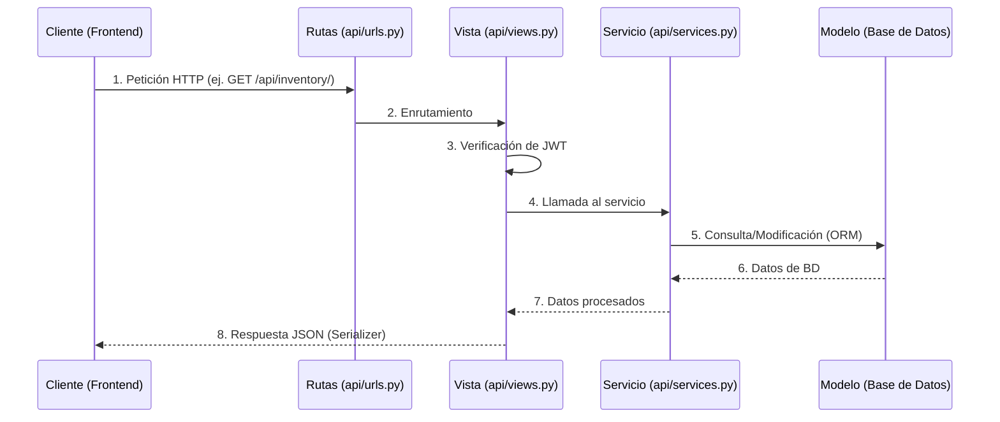

# Documentación Técnica del Backend (SICPF Core)

Este documento detalla la arquitectura técnica, el flujo de información y las rutas de la API del sistema SICPF.

## Estructura del Proyecto

El backend está desarrollado utilizando Django y Django REST Framework, aplicando un patrón Modelo-Vista-Controlador (MVC) estricto con una capa de servicios.

- `sicpf_core/`: Configuraciones principales del proyecto Django (settings, urls, wsgi).
- `api/`: Aplicación principal que contiene la lógica de negocio.
  - `models.py`: Definición de la base de datos (Inventario, Ventas, Alertas, Recomendaciones).
  - `services.py`: Capa de servicios que concentra la lógica de negocio (operaciones CRUD).
  - `views.py`: Controladores HTTP genéricos encargados de manejar las peticiones, verificar autenticación e invocar los servicios.
  - `serializers.py`: Transformación de modelos a formato JSON.
  - `urls.py`: Enrutador de los endpoints de la API.

## Flujo de Información

La arquitectura garantiza que la lógica de negocio se mantenga separada del manejo HTTP.

## Rutas de la API (Endpoints)

Todas las rutas requieren el envío de un token JWT válido en las cabeceras (`Authorization: Bearer <token>`), a excepción de las rutas de obtención y refresco de tokens.

### Autenticación y Documentación

| Método | Endpoint | Descripción |
| :--- | :--- | :--- |
| `POST` | `/api/auth/token/` | Obtener token de acceso y refresco. |
| `POST` | `/api/auth/token/refresh/` | Renovar un token expirado. |
| `GET` | `/api/docs/` | Interfaz Swagger UI de la API. |

### Inventario (`/api/inventory/`)

| Método | Endpoint | Descripción |
| :--- | :--- | :--- |
| `GET` | `/api/inventory/` | Obtener todos los items del inventario. |
| `POST` | `/api/inventory/create/` | Crear un nuevo item. |
| `GET` | `/api/inventory/<id>/` | Obtener detalles de un item específico. |
| `PUT/PATCH` | `/api/inventory/<id>/update/` | Modificar un item. |
| `DELETE` | `/api/inventory/<id>/delete/` | Eliminar un item. |

### Ventas (`/api/sales/`)

| Método | Endpoint | Descripción |
| :--- | :--- | :--- |
| `GET` | `/api/sales/` | Listado general de ventas. |
| `POST` | `/api/sales/create/` | Registrar nueva venta. |
| `GET` | `/api/sales/<id>/` | Consultar detalle de venta. |
| `PUT/PATCH` | `/api/sales/<id>/update/` | Modificar estado de venta. |
| `DELETE` | `/api/sales/<id>/delete/` | Cancelar/eliminar venta. |

### Alertas (`/api/alerts/`)

| Método | Endpoint | Descripción |
| :--- | :--- | :--- |
| `GET` | `/api/alerts/` | Obtener alertas del sistema. |
| `POST` | `/api/alerts/create/` | Crear nueva alerta. |
| `GET` | `/api/alerts/<id>/` | Detalle de alerta. |
| `PUT/PATCH` | `/api/alerts/<id>/update/` | Actualizar alerta. |
| `DELETE` | `/api/alerts/<id>/delete/` | Descartar alerta. |

### Recomendaciones (`/api/recommendations/`)

| Método | Endpoint | Descripción |
| :--- | :--- | :--- |
| `GET` | `/api/recommendations/` | Listar sugerencias automáticas. |
| `POST` | `/api/recommendations/create/` | Ingresar nueva recomendación. |
| `GET` | `/api/recommendations/<id>/` | Ver recomendación puntual. |
| `PUT/PATCH` | `/api/recommendations/<id>/update/` | Modificar recomendación. |
| `DELETE` | `/api/recommendations/<id>/delete/` | Borrar recomendación. |
