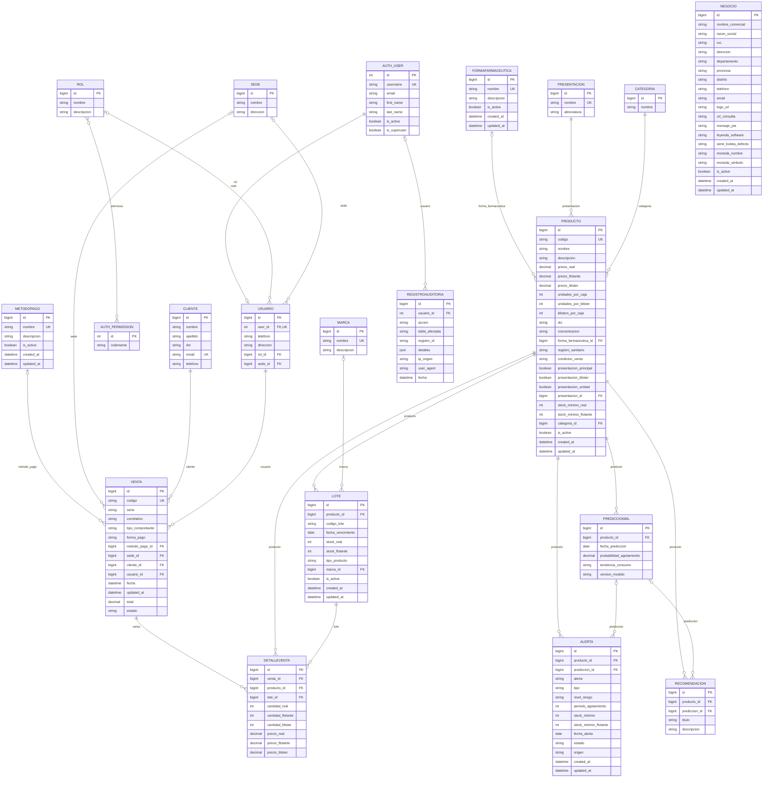

# Diagrama y diccionario de datos

Esquema de la aplicación `api`, contrastado con los modelos actuales y sus migraciones. Las [reglas operativas](README.md) explican stock, ventas, alertas y configuración. La [documentación de la API](../README.md) distingue los campos persistidos de los datos añadidos a las respuestas.

## Diagrama entidad-relación

Se muestran todas las entidades de negocio y sus columnas. `AUTH_USER` y `AUTH_PERMISSION` se representan de forma abreviada: pertenecen a Django. La relación M2M de permisos utiliza una tabla intermedia automática; las tablas de grupos, sesiones, tokens y demás infraestructura de Django no se expanden.

La cardinalidad de venta a detalles permite cero filas en el esquema relacional; la API exige al menos un detalle al crear una venta. `Negocio` no tiene relación FK con `Venta`.

## Diccionario de columnas

Los nombres con sufijo `_id` son columnas FK; en el ORM se accede a ellas por el nombre de la relación. `NULL` indica nulabilidad SQL y `Vacío` corresponde a `blank=True` en la validación de Django, no a una garantía de todas las interfaces. Los defaults son de modelo; no se afirma que sean defaults SQL. `PK` y `UNIQUE` indican restricciones declaradas.

### Categoria

Tabla: `api_categoria`.

| Columna / relación | Tipo Django | NULL | Vacío | Restricciones, default o relación |
| --- | --- | --- | --- | --- |
| `id` | BigAutoField | No | Sí | PK autogenerada |
| `nombre` | CharField | No | No | max_length=100 |

### Presentacion

Tabla: `api_presentacion`.

| Columna / relación | Tipo Django | NULL | Vacío | Restricciones, default o relación |
| --- | --- | --- | --- | --- |
| `id` | BigAutoField | No | Sí | PK autogenerada |
| `nombre` | CharField | No | No | UNIQUE; max_length=50 |
| `abreviatura` | CharField | Sí | Sí | max_length=10 |

### Marca

Tabla: `api_marca`.

| Columna / relación | Tipo Django | NULL | Vacío | Restricciones, default o relación |
| --- | --- | --- | --- | --- |
| `id` | BigAutoField | No | Sí | PK autogenerada |
| `nombre` | CharField | No | No | UNIQUE; max_length=100 |
| `descripcion` | TextField | Sí | Sí | — |

### FormaFarmaceutica

Tabla: `api_formafarmaceutica`.

| Columna / relación | Tipo Django | NULL | Vacío | Restricciones, default o relación |
| --- | --- | --- | --- | --- |
| `id` | BigAutoField | No | Sí | PK autogenerada |
| `nombre` | CharField | No | No | UNIQUE; max_length=100 |
| `descripcion` | TextField | Sí | Sí | — |
| `is_active` | BooleanField | No | No | default=True |
| `created_at` | DateTimeField | No | Sí | fecha automática al crear |
| `updated_at` | DateTimeField | No | Sí | fecha automática al guardar |

### Producto

Tabla: `api_producto`.

| Columna / relación | Tipo Django | NULL | Vacío | Restricciones, default o relación |
| --- | --- | --- | --- | --- |
| `id` | BigAutoField | No | Sí | PK autogenerada |
| `codigo` | CharField | No | No | UNIQUE; max_length=50 |
| `nombre` | CharField | No | No | max_length=200 |
| `descripcion` | TextField | Sí | Sí | — |
| `precio_real` | DecimalField | No | No | precisión 10, escala 2 |
| `precio_flotante` | DecimalField | No | No | precisión 10, escala 2 |
| `precio_blister` | DecimalField | No | No | precisión 10, escala 2; default=0 |
| `unidades_por_caja` | IntegerField | No | No | default=1 |
| `unidades_por_blister` | IntegerField | No | No | default=1 |
| `blisters_por_caja` | IntegerField | No | No | default=1 |
| `dci` | CharField | Sí | Sí | max_length=200 |
| `concentracion` | CharField | Sí | Sí | max_length=100 |
| `forma_farmaceutica_id` | ForeignKey | Sí | Sí | api.FormaFarmaceutica; PROTECT |
| `registro_sanitario` | CharField | Sí | Sí | max_length=50 |
| `condicion_venta` | CharField | No | No | max_length=30; default='libre'; valores: libre, receta, receta_retenida |
| `presentacion_principal` | BooleanField | No | No | default=True |
| `presentacion_blister` | BooleanField | No | No | default=True |
| `presentacion_unidad` | BooleanField | No | No | default=True |
| `presentacion_id` | ForeignKey | No | No | api.Presentacion; PROTECT |
| `stock_minimo_real` | IntegerField | No | No | default=10 |
| `stock_minimo_flotante` | IntegerField | No | No | default=20 |
| `categoria_id` | ForeignKey | No | No | api.Categoria; CASCADE |
| `is_active` | BooleanField | No | No | default=True |
| `created_at` | DateTimeField | No | Sí | fecha automática al crear |
| `updated_at` | DateTimeField | No | Sí | fecha automática al guardar |

### Lote

Tabla: `api_lote`.

| Columna / relación | Tipo Django | NULL | Vacío | Restricciones, default o relación |
| --- | --- | --- | --- | --- |
| `id` | BigAutoField | No | Sí | PK autogenerada |
| `producto_id` | ForeignKey | No | No | api.Producto; CASCADE |
| `codigo_lote` | CharField | No | No | max_length=100 |
| `fecha_vencimiento` | DateField | No | No | — |
| `stock_real` | IntegerField | No | No | default=0 |
| `stock_flotante` | IntegerField | No | No | default=0 |
| `tipo_producto` | CharField | No | No | max_length=20; default='generico'; valores: marca, generico |
| `marca_id` | ForeignKey | Sí | Sí | api.Marca; SET_NULL |
| `is_active` | BooleanField | No | No | default=True |
| `created_at` | DateTimeField | No | Sí | fecha automática al crear |
| `updated_at` | DateTimeField | No | Sí | fecha automática al guardar |

### PrediccionML

Tabla: `api_prediccionml`.

| Columna / relación | Tipo Django | NULL | Vacío | Restricciones, default o relación |
| --- | --- | --- | --- | --- |
| `id` | BigAutoField | No | Sí | PK autogenerada |
| `producto_id` | ForeignKey | No | No | api.Producto; CASCADE |
| `fecha_prediccion` | DateField | No | No | — |
| `probabilidad_agotamiento` | DecimalField | No | No | precisión 5, escala 4 |
| `tendencia_consumo` | CharField | No | No | max_length=50 |
| `version_modelo` | CharField | No | No | max_length=50 |

### Alerta

Tabla: `api_alerta`.

| Columna / relación | Tipo Django | NULL | Vacío | Restricciones, default o relación |
| --- | --- | --- | --- | --- |
| `id` | BigAutoField | No | Sí | PK autogenerada |
| `producto_id` | ForeignKey | No | No | api.Producto; CASCADE |
| `prediccion_id` | ForeignKey | Sí | Sí | api.PrediccionML; SET_NULL |
| `alerta` | CharField | No | No | max_length=200 |
| `tipo` | CharField | Sí | Sí | max_length=20; valores: stock_critico, stock_bajo, vencimiento, quiebre |
| `nivel_riesgo` | CharField | No | No | max_length=50 |
| `periodo_agotamiento` | IntegerField | No | No | — |
| `stock_minimo` | IntegerField | No | No | — |
| `stock_minimo_flotante` | IntegerField | Sí | Sí | — |
| `fecha_alerta` | DateField | No | No | — |
| `estado` | CharField | No | No | max_length=20; default='pendiente'; valores: pendiente, revisada, descartada |
| `origen` | CharField | No | No | max_length=20; default='reglas'; valores: reglas, ml, manual |
| `created_at` | DateTimeField | No | Sí | fecha automática al crear |
| `updated_at` | DateTimeField | No | Sí | fecha automática al guardar |

### Recomendacion

Tabla: `api_recomendacion`.

| Columna / relación | Tipo Django | NULL | Vacío | Restricciones, default o relación |
| --- | --- | --- | --- | --- |
| `id` | BigAutoField | No | Sí | PK autogenerada |
| `producto_id` | ForeignKey | No | No | api.Producto; CASCADE |
| `prediccion_id` | ForeignKey | Sí | Sí | api.PrediccionML; SET_NULL |
| `titulo` | CharField | No | No | max_length=200 |
| `descripcion` | TextField | No | No | — |

### Cliente

Tabla: `api_cliente`.

| Columna / relación | Tipo Django | NULL | Vacío | Restricciones, default o relación |
| --- | --- | --- | --- | --- |
| `id` | BigAutoField | No | Sí | PK autogenerada |
| `nombre` | CharField | No | No | max_length=100 |
| `apellido` | CharField | Sí | Sí | max_length=100 |
| `dni` | CharField | Sí | Sí | max_length=8 |
| `email` | CharField | No | No | UNIQUE; max_length=254 |
| `telefono` | CharField | Sí | Sí | max_length=50 |

### Rol

Tabla: `api_rol`.

| Columna / relación | Tipo Django | NULL | Vacío | Restricciones, default o relación |
| --- | --- | --- | --- | --- |
| `id` | BigAutoField | No | Sí | PK autogenerada |
| `nombre` | CharField | No | No | max_length=100 |
| `descripcion` | TextField | Sí | Sí | — |
| `permisos` | ManyToManyField | — | Sí | M2M con auth.Permission; tabla api_rol_permisos |

### Sede

Tabla: `api_sede`.

| Columna / relación | Tipo Django | NULL | Vacío | Restricciones, default o relación |
| --- | --- | --- | --- | --- |
| `id` | BigAutoField | No | Sí | PK autogenerada |
| `nombre` | CharField | No | No | max_length=100 |
| `direccion` | TextField | Sí | Sí | — |

### Usuario

Tabla: `api_usuario`.

| Columna / relación | Tipo Django | NULL | Vacío | Restricciones, default o relación |
| --- | --- | --- | --- | --- |
| `id` | BigAutoField | No | Sí | PK autogenerada |
| `user_id` | OneToOneField | No | No | auth.User; CASCADE; UNIQUE |
| `telefono` | CharField | Sí | Sí | max_length=50 |
| `direccion` | TextField | Sí | Sí | — |
| `rol_id` | ForeignKey | Sí | Sí | api.Rol; SET_NULL |
| `sede_id` | ForeignKey | Sí | Sí | api.Sede; SET_NULL |

### MetodoPago

Tabla: `api_metodopago`.

| Columna / relación | Tipo Django | NULL | Vacío | Restricciones, default o relación |
| --- | --- | --- | --- | --- |
| `id` | BigAutoField | No | Sí | PK autogenerada |
| `nombre` | CharField | No | No | UNIQUE; max_length=100 |
| `descripcion` | TextField | Sí | Sí | — |
| `is_active` | BooleanField | No | No | default=True |
| `created_at` | DateTimeField | No | Sí | fecha automática al crear |
| `updated_at` | DateTimeField | No | Sí | fecha automática al guardar |

### Venta

Tabla: `api_venta`.

| Columna / relación | Tipo Django | NULL | Vacío | Restricciones, default o relación |
| --- | --- | --- | --- | --- |
| `id` | BigAutoField | No | Sí | PK autogenerada |
| `codigo` | CharField | No | No | UNIQUE; max_length=50 |
| `serie` | CharField | No | No | max_length=10; default='B001' |
| `correlativo` | CharField | Sí | Sí | max_length=20 |
| `tipo_comprobante` | CharField | No | No | max_length=20; default='Boleta'; valores: Boleta |
| `forma_pago` | CharField | No | No | max_length=30; default='Contado' |
| `metodo_pago_id` | ForeignKey | Sí | Sí | api.MetodoPago; PROTECT |
| `sede_id` | ForeignKey | Sí | Sí | api.Sede; PROTECT |
| `cliente_id` | ForeignKey | No | No | api.Cliente; PROTECT |
| `usuario_id` | ForeignKey | No | No | api.Usuario; PROTECT |
| `fecha` | DateTimeField | No | Sí | fecha automática al crear |
| `updated_at` | DateTimeField | No | Sí | fecha automática al guardar |
| `total` | DecimalField | No | No | precisión 12, escala 2 |
| `estado` | CharField | No | No | max_length=20; default='Completado'; valores: Pendiente, Completado, Cancelado |

### DetalleVenta

Tabla: `api_detalleventa`.

| Columna / relación | Tipo Django | NULL | Vacío | Restricciones, default o relación |
| --- | --- | --- | --- | --- |
| `id` | BigAutoField | No | Sí | PK autogenerada |
| `venta_id` | ForeignKey | No | No | api.Venta; CASCADE |
| `producto_id` | ForeignKey | No | No | api.Producto; PROTECT |
| `lote_id` | ForeignKey | No | No | api.Lote; PROTECT |
| `cantidad_real` | IntegerField | No | No | default=0 |
| `cantidad_flotante` | IntegerField | No | No | default=0 |
| `cantidad_blister` | IntegerField | No | No | default=0 |
| `precio_real` | DecimalField | No | No | precisión 10, escala 2 |
| `precio_flotante` | DecimalField | No | No | precisión 10, escala 2 |
| `precio_blister` | DecimalField | No | No | precisión 10, escala 2; default=0 |

### RegistroAuditoria

Tabla: `api_registroauditoria`.

| Columna / relación | Tipo Django | NULL | Vacío | Restricciones, default o relación |
| --- | --- | --- | --- | --- |
| `id` | BigAutoField | No | Sí | PK autogenerada |
| `usuario_id` | ForeignKey | Sí | Sí | auth.User; SET_NULL |
| `accion` | CharField | No | No | max_length=50; valores: LOGIN_EXITOSO, LOGIN_FALLIDO, LOGOUT, CREACION, MODIFICACION, ELIMINACION, ANULACION_VENTA, CAMBIO_PASSWORD, ACCESO_DENEGADO, ALERTA_GESTIONADA |
| `tabla_afectada` | CharField | Sí | Sí | max_length=100 |
| `registro_id` | CharField | Sí | Sí | max_length=100 |
| `detalles` | JSONField | No | Sí | default=dict |
| `ip_origen` | GenericIPAddressField | Sí | Sí | max_length=39 |
| `user_agent` | TextField | Sí | Sí | — |
| `fecha` | DateTimeField | No | Sí | fecha automática al crear |

### Negocio

Tabla: `api_negocio`.

| Columna / relación | Tipo Django | NULL | Vacío | Restricciones, default o relación |
| --- | --- | --- | --- | --- |
| `id` | BigAutoField | No | Sí | PK autogenerada |
| `nombre_comercial` | CharField | No | No | max_length=150; default='SICPF' |
| `razon_social` | CharField | No | Sí | max_length=200; default='' |
| `ruc` | CharField | No | Sí | max_length=11; default='' |
| `direccion` | CharField | No | Sí | max_length=255; default='' |
| `departamento` | CharField | No | Sí | max_length=100; default='' |
| `provincia` | CharField | No | Sí | max_length=100; default='' |
| `distrito` | CharField | No | Sí | max_length=100; default='' |
| `telefono` | CharField | Sí | Sí | max_length=50 |
| `email` | CharField | Sí | Sí | max_length=254 |
| `logo_url` | CharField | Sí | Sí | max_length=500 |
| `url_consulta` | CharField | No | Sí | max_length=255; default='' |
| `mensaje_pie` | TextField | No | No | default='¡GRACIAS POR SU COMPRA!' |
| `leyenda_software` | CharField | No | No | max_length=150; default='Generado por SICPF' |
| `serie_boleta_defecto` | CharField | No | No | max_length=4; default='B001' |
| `moneda_nombre` | CharField | No | No | max_length=20; default='SOLES' |
| `moneda_simbolo` | CharField | No | No | max_length=5; default='S/' |
| `is_active` | BooleanField | No | No | default=True |
| `created_at` | DateTimeField | No | Sí | fecha automática al crear |
| `updated_at` | DateTimeField | No | Sí | fecha automática al guardar |

## Interpretación y límites del esquema

- `PROTECT` impide borrar un registro referenciado; `CASCADE` elimina dependientes; `SET_NULL` conserva el dependiente sin esa relación. Estas son políticas del ORM de Django.
- Producto, lote y método de pago se desactivan mediante sus endpoints DELETE; la política FK sigue siendo relevante para borrados físicos desde otras rutas del ORM.
- `Rol.permisos` usa la tabla M2M automática y se sincroniza con grupos de Django. No es una columna JSON ni un sistema de capacidades aplicado automáticamente a todas las vistas.
- El nombre, apellido y email del perfil proceden de `auth.User`; `Usuario` no tiene columnas propias con esos nombres. `auth.User.email` no es único en el esquema estándar de Django.
- El estado de producto o lote, el tipo agregado y las marcas del producto, y los importes tributarios calculados de venta no son columnas. Consulte la sección de campos calculados de las reglas de datos.
- El esquema no declara restricciones CHECK de no negatividad para precios, cantidades o stock. No se garantiza esa regla a partir del tipo IntegerField o DecimalField.
- El esquema tampoco impone unicidad en RUC, código de lote, combinación serie-correlativo o número de negocios activos.
- Los índices de consulta se declaran en Meta.indexes de Producto, Lote, Alerta, Venta y RegistroAuditoria, además de los índices derivados de claves y relaciones. Un índice ordinario no añade unicidad.
- Las propiedades y anotaciones calculadas no deben añadirse a este diagrama como si fueran columnas; los serializers pueden devolverlas junto con las relaciones y sus nombres descriptivos.
