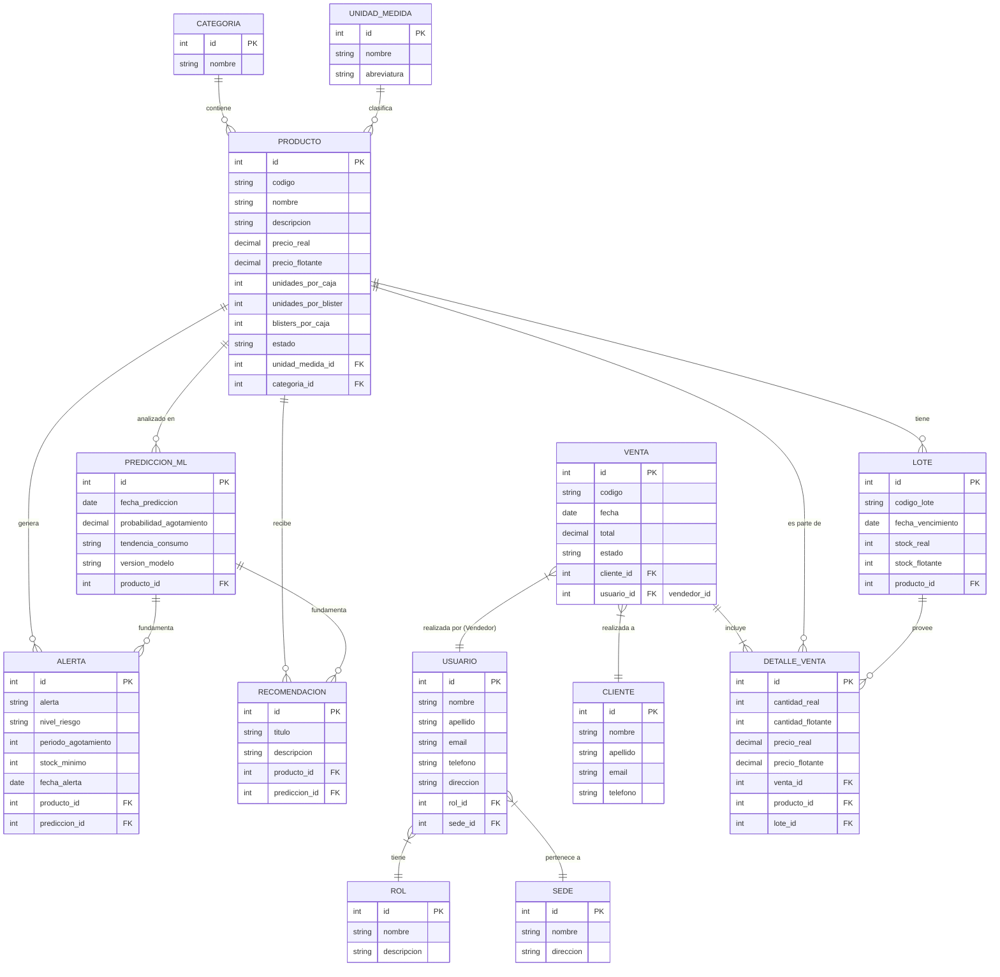

# Diseño de la base de datos

### Diagrama Entidad-Relación

### Entidades

- Producto:
  - id
  - codigo
  - nombre
  - descripcion
  - precio_real
  - precio_flotante
  - unidades_por_caja (factor de conversión principal)
  - unidades_por_blister (factor de conversión blister)
  - blisters_por_caja (factor de conversión caja)
  - categoria_id
  - estado: "activo", "por vencer", "vencido"
  - unidad_medida_id (referencia al catálogo UnidadMedida)
- Lote:
  - id
  - producto_id
  - codigo_lote
  - fecha_vencimiento
  - stock_real
  - stock_flotante
- Categoria:
  - id
  - nombre
- UnidadMedida:
  - id
  - nombre
  - abreviatura
- Sede:
  - id
  - nombre
  - direccion
- PrediccionML:
  - id
  - producto_id
  - fecha_prediccion
  - probabilidad_agotamiento
  - tendencia_consumo: "alta", "moderada", "baja"
  - version_modelo
- Recomendacion:
  - id
  - producto_id
  - prediccion_id (opcional)
  - titulo
  - descripcion
- Alerta:
  - id
  - producto_id
  - prediccion_id (opcional)
  - alerta
  - nivel_riesgo
  - periodo_agotamiento (en días)
  - stock_minimo
  - fecha_alerta
- Cliente:
  - id
  - nombre
  - apellido
  - email
  - telefono
- Usuario:
  - id
  - nombre
  - apellido
  - email
  - telefono
  - direccion
  - rol_id
  - sede_id
- Rol:
  - id
  - nombre
  - descripcion
  - permisos (Relación M2M nativa con auth_permission)
- Venta:
  - id
  - codigo
  - cliente_id (referencia obligatoria a un Cliente, pudiendo usar uno Genérico)
  - usuario_id
  - fecha
  - total
  - estado: "cancelado", "completado", "finalizado"
- Detalle Venta:
  - id
  - venta_id
  - producto_id
  - lote_id
  - cantidad_real
  - cantidad_flotante
  - precio_real
  - precio_flotante

### Relaciones

- Una **Categoria** contiene muchos **Productos** (1 a N).
- Una **UnidadMedida** clasifica muchos **Productos** (1 a N).
- Un **Producto** tiene muchos **Lotes** (1 a N).
- Un **Producto** genera muchas **Alertas** (1 a N).
- Un **Producto** recibe muchas **Recomendaciones** (1 a N).
- Un **Producto** es analizado en muchas **Predicciones ML** (1 a N).
- Una **PrediccionML** fundamenta muchas **Alertas** (1 a N).
- Una **PrediccionML** fundamenta muchas **Recomendaciones** (1 a N).
- Un **Rol** pertenece a muchos **Usuarios** (1 a N).
- Una **Sede** aloja a muchos **Usuarios** (1 a N).
- Un **Cliente** tiene muchas **Ventas** (1 a N).
- Un **Usuario** (Vendedor) realiza muchas **Ventas** (1 a N).
- Una **Venta** incluye muchos **Detalles de Venta** (1 a N).
- Un **Producto** es parte de muchos **Detalles de Venta** (1 a N).
- Un **Lote** provee a muchos **Detalles de Venta** (1 a N).

### Restricciones

- `precio_real` y `precio_flotante` (en `Producto` y `Detalle Venta`) no pueden ser negativos (`>= 0`).
- `stock_real`, `stock_flotante` (en `Lote`) no pueden ser negativos (`>= 0`).
- `stock_minimo` (en `Alerta`) no puede ser negativo (`>= 0`).
- `cantidad_real` y `cantidad_flotante` (en `Detalle Venta`) no pueden ser negativos (`>= 0`).
- `email` (en `Cliente` y `Usuario`) debe ser único (`UNIQUE`).
