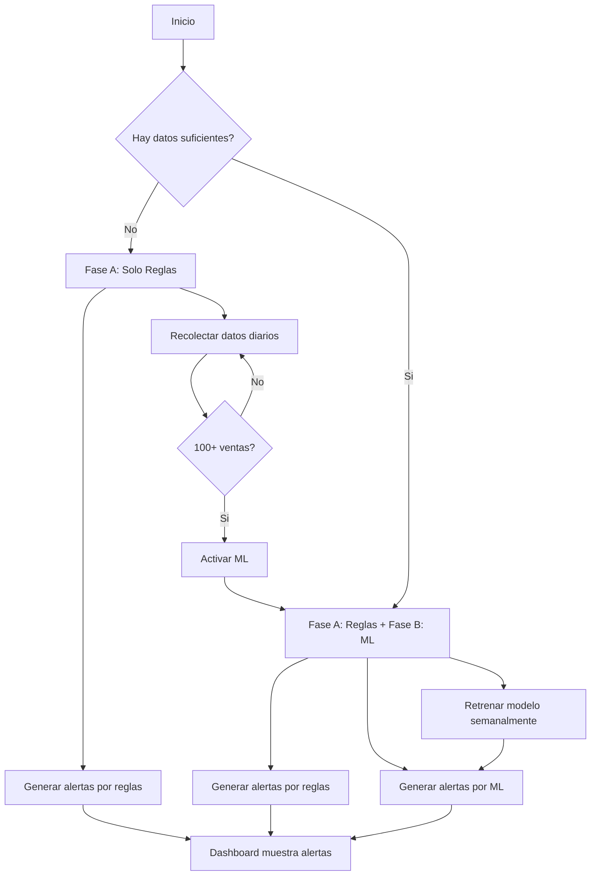
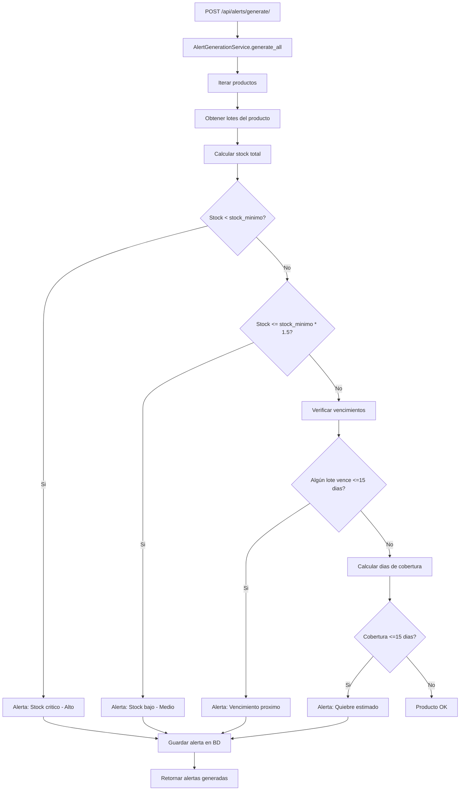
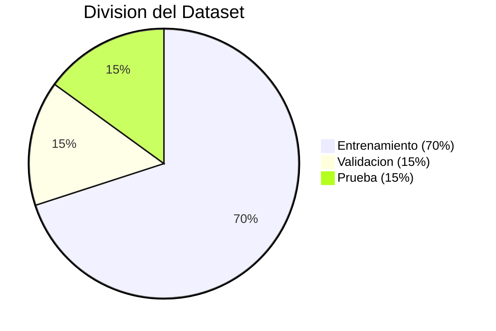
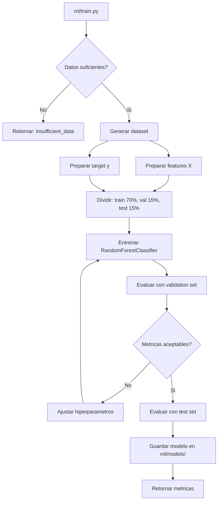
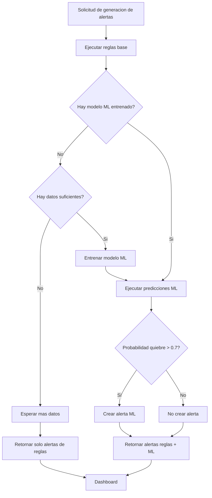
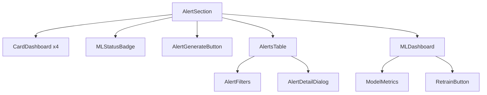
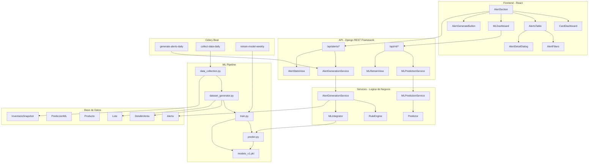
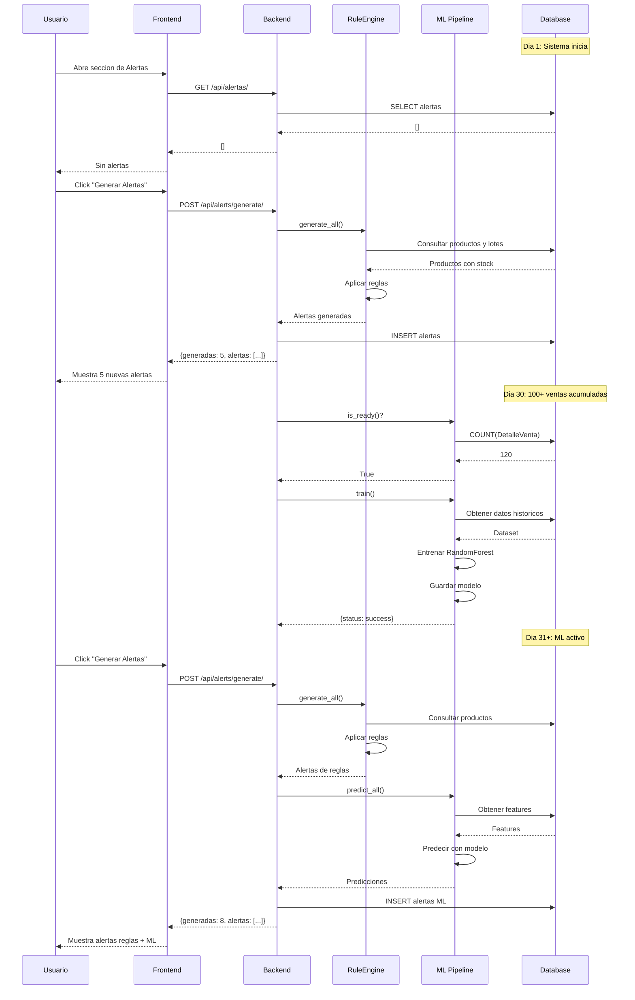

# Plan de Implementacion: Feature de Alertas con IA (Opcion E - Hybrid)

**Proyecto:** SICPF - Sistema Inteligente de Control de Productos Farmaceuticos
**Fecha:** 2026-08-21
**Branch:** feature/alert
**Arquitectura:** Hybrid (Reglas + ML ligero)

---

## 1. Resumen Ejecutivo

### Decisiones del Cliente

| Decision | Valor |
|----------|-------|
| Arquitectura | **Hybrid** (Reglas + ML ligero) |
| Datos actuales | Solo datos mock (`populate_db.py`) |
| Retrenamiento | **Automatico** (Celery + Beat) |
| Notificaciones | Solo dashboard (sin push) |
| Horizonte de prediccion | **15 dias** |

### Estado Actual del Proyecto

| Capa | Estado |
|------|--------|
| **Backend** | Modelos `Alerta`, `PrediccionML`, `Recomendacion` existen pero sin logica de generacion. Solo CRUD generico. |
| **Frontend** | `AlertSection`, `AlertsTable`, Zustand store funcionales. Muestra stats y tabla con filtros. |
| **IA/ML** | Sin codigo ML. Modelo `PrediccionML` es un stub con datos mock de `populate_db.py`. |
| **Datos** | Historial de ventas + Lotes + Productos disponibles para construir dataset. |

### Archivos Clave Existentes

- `source/backend/api/models.py` - Modelos de datos (lineas 67-108: PrediccionML, Alerta, Recomendacion)
- `source/backend/api/views.py` - Vistas CRUD + AlertStatsView
- `source/backend/api/services.py` - Servicios genericos (sin logica de alertas)
- `source/frontend/src/features/alerts/` - Feature module de alertas
- `source/frontend/src/components/sections/AlertSection.tsx` - Seccion principal

---

## 2. Estrategia: Dos Fases Adaptativas

La implementacion se divide en dos fases que trabajan en paralelo:

1. **Fase A: Motor de Reglas** - Proporciona valor inmediato desde el dia 1, sin necesidad de datos historicos reales.
2. **Fase B: Pipeline ML** - Se disena desde el inicio pero se activa automaticamente cuando haya suficiente historial de ventas (minimo ~100 transacciones).



---

## 3. Fase A: Motor de Reglas (Backend)

### 3.1 Servicio de Generacion basado en Reglas

**Archivo:** `source/backend/api/services.py` - `AlertGenerationService`

#### Variables de Entrada

- `stock_real` / `stock_flotante` del `Lote`
- `fecha_vencimiento` del `Lote`
- `unidades_por_caja`, `unidades_por_blister` del `Producto`
- Historial de ventas del producto (ultimos 30/60/90 dias)
- `stock_minimo` (configurable por producto o categoria)

#### Reglas a Implementar

| # | Regla | Condicion | Nivel de Riesgo |
|---|-------|-----------|-----------------|
| 1 | Stock critico | `stock_total < stock_minimo` | Alto |
| 2 | Stock bajo | `stock_total <= stock_minimo * 1.5` | Medio |
| 3 | Vencimiento proximo | `fecha_vencimiento <= hoy + 15 dias` | Medio/Alto |
| 4 | Producto vencido | `fecha_vencimiento < hoy` | Alto |
| 5 | Prediccion de quiebre | `dias_cobertura <= 15 dias` | Alto/Medio |

#### Codigo del Servicio

```python
class AlertGenerationService:
    DIAS_HORIZONTE = 15  # Horizonte de prediccion
    
    @classmethod
    def generate_all(cls):
        """Genera alertas basadas en reglas para todos los productos"""
        alertas_generadas = []
        
        for producto in Producto.objects.all():
            lotes = producto.lotes.all()
            stock_total_real = sum(l.stock_real for l in lotes)
            stock_total_flotante = sum(l.stock_flotante for l in lotes)
            
            # Regla 1: Stock critico
            if stock_total_real <= cls._get_stock_minimo(producto):
                alertas_generadas.append(cls._crear_alerta_stock(
                    producto, stock_total_real, 'alto', 'critico'
                ))
            
            # Regla 2: Stock bajo
            elif stock_total_real <= cls._get_stock_minimo(producto) * 1.5:
                alertas_generadas.append(cls._crear_alerta_stock(
                    producto, stock_total_real, 'medio', 'bajo'
                ))
            
            # Regla 3: Vencimiento proximo (<=15 dias)
            for lote in lotes:
                dias_vencimiento = (lote.fecha_vencimiento - date.today()).days
                if dias_vencimiento <= 0:
                    alertas_generadas.append(cls._crear_alerta_vencimiento(
                        producto, lote, 'alto', 'vencido'
                    ))
                elif dias_vencimiento <= 15:
                    alertas_generadas.append(cls._crear_alerta_vencimiento(
                        producto, lote, 'medio', 'por vencer'
                    ))
            
            # Regla 4: Prediccion de quiebre por rotacion
            dias_cobertura = cls._calcular_dias_cobertura(
                stock_total_real, stock_total_flotante, producto
            )
            if dias_cobertura <= cls.DIAS_HORIZONTE:
                alertas_generadas.append(cls._crear_alerta_quiebre(
                    producto, dias_cobertura
                ))
        
        return alertas_generadas
    
    @classmethod
    def _calcular_dias_cobertura(cls, stock_real, stock_flotante, producto):
        """Calcula cuantos dias durara el stock actual"""
        ventas_promedio = cls._get_ventas_promedio(producto, dias=30)
        
        if ventas_promedio == 0:
            ventas_promedio = 1  # Estimacion conservadora
        
        total_unidades = (stock_real * producto.unidades_por_caja) + stock_flotante
        return total_unidades / ventas_promedio if ventas_promedio > 0 else 999
```

### 3.2 Modelo `Alerta` Extendido

```python
class Alerta(models.Model):
    # ... campos existentes ...
    ESTADO_CHOICES = (
        ('pendiente', 'Pendiente'),
        ('revisada', 'Revisada'),
        ('descartada', 'Descartada')
    )
    estado = models.CharField(max_length=20, choices=ESTADO_CHOICES, default='pendiente')
    origen = models.CharField(max_length=20, choices=[
        ('reglas', 'Reglas'),
        ('ml', 'ML'),
        ('manual', 'Manual')
    ], default='reglas')
    created_at = models.DateTimeField(auto_now_add=True)
    updated_at = models.DateTimeField(auto_now=True)
```

### 3.3 Nuevos Endpoints

```python
class AlertGenerateView(APIView):
    """POST /api/alerts/generate/ - Genera alertas con reglas"""
    permission_classes = [IsAuthenticated]
    
    def post(self, request):
        alertas = AlertGenerationService.generate_all()
        return Response({
            'generadas': len(alertas),
            'alertas': AlertaSerializer(alertas, many=True).data
        })

class AlertPendingView(APIView):
    """GET /api/alerts/pending/ - Alertas pendientes"""
    permission_classes = [IsAuthenticated]
    
    def get(self, request):
        pendientes = Alerta.objects.filter(estado='pendiente')
        return Response(AlertaSerializer(pendientes, many=True).data)
```

### 3.4 Flujo de Generacion de Alertas



---

## 4. Fase B: Pipeline ML (Disenado para Acumular Datos)

### 4.1 Estructura de Archivos

```
source/backend/ml/
├── __init__.py
├── config.py              # Configuracion del pipeline
├── data_collection.py     # Recopilacion de datos diarios
├── dataset_generator.py   # Genera dataset desde la BD
├── features.py            # Feature engineering
├── train.py               # Entrenamiento del modelo
├── predict.py             # Inferencia
├── evaluate.py            # Metricas de evaluacion
├── tasks.py               # Tareas Celery para ML
├── models/
│   └── .gitkeep
└── requirements_ml.txt
```

### 4.2 Recolector de Datos (Se activa desde el dia 1)

```python
# ml/data_collection.py

class DataCollector:
    """Recopila datos diariamente para construir el dataset"""
    
    @classmethod
    def collect_daily_snapshot(cls):
        """Captura snapshot diario del estado del inventario"""
        snapshot = []
        
        for producto in Producto.objects.all():
            lotes = producto.lotes.all()
            
            row = {
                'fecha': date.today(),
                'producto_id': producto.id,
                'categoria': producto.categoria.nombre,
                'stock_real': sum(l.stock_real for l in lotes),
                'stock_flotante': sum(l.stock_flotante for l in lotes),
                'dias_hasta_vencimiento_min': cls._min_dias_vencimiento(lotes),
                'precio_real': float(producto.precio_real),
                'unidades_por_caja': producto.unidades_por_caja,
                'estado': producto.estado,
                'ventas_hoy': 0,  # Se actualiza al final del dia
            }
            snapshot.append(row)
        
        cls._save_snapshot(snapshot)
        return snapshot
    
    @classmethod
    def update_daily_sales(cls, fecha=None):
        """Actualiza las ventas del dia en el snapshot"""
        if fecha is None:
            fecha = date.today()
        
        ventas_del_dia = DetalleVenta.objects.filter(
            venta__fecha__date=fecha,
            venta__estado='Completado'
        ).values('producto_id').annotate(
            total_vendido=Sum('cantidad_real')
        )
        
        for venta in ventas_del_dia:
            cls._update_snapshot_venta(
                fecha=fecha,
                producto_id=venta['producto_id'],
                vendidos=venta['total_vendido']
            )
```

### 4.3 Variables del Modelo (Features)

| Variable | Tipo | Descripcion | Fuente |
|----------|------|-------------|--------|
| `producto_id` | Categorical | Identificador del producto | `Producto` |
| `categoria` | Categorical | Categoria del producto | `Categoria` |
| `stock_real_actual` | Numerico | Stock en cajas | `Lote` |
| `stock_flotante_actual` | Numerico | Stock en unidades sueltas | `Lote` |
| `dias_hasta_vencimiento` | Numerico | Dias restantes hasta vencimiento | `Lote.fecha_vencimiento` |
| `ventas_ultimos_30d` | Numerico | Unidades vendidas ultimos 30 dias | `DetalleVenta` |
| `ventas_ultimos_60d` | Numerico | Unidades vendidos ultimos 60 dias | `DetalleVenta` |
| `ventas_ultimos_90d` | Numerico | Unidades vendidos ultimos 90 dias | `DetalleVenta` |
| `tasa_crecimiento_ventas` | Numerico | (ventas_30d / ventas_60d_anteriores) - 1 | Calculado |
| `dia_semana` | Categorical | Dia de la semana (0-6) | `Venta.fecha` |
| `mes` | Categorical | Mes del anio (1-12) | `Venta.fecha` |
| `precio_real` | Numerico | Precio de caja | `Producto` |
| `unidades_por_caja` | Numerico | Unidades por caja | `Producto` |
| `rotacion_inventario` | Numerico | stock_real / ventas_30d (dias de cobertura) | Calculado |
| `es_por_vencer` | Boolean | Si el producto tiene estado "por vencer" | `Producto` |

#### Variable Objetivo (Target)

- `quiebre_stock` -> Binario (1 = se agota en <=15 dias, 0 = no se agota)
- `nivel_riesgo` -> Multiclase ("bajo", "medio", "alto")

### 4.4 Dataset para Entrenamiento y Validacion

#### Fuentes de Datos

1. **`DetalleVenta`** - Historico de ventas por producto (tabla de hechos principal)
2. **`Venta`** - Fechas, estados, totales
3. **`Lote`** - Stock actual, fechas de vencimiento
4. **`Producto`** - Categorias, precios, unidades
5. **`Categoria`** - Nombres de categorias

#### Estructura del Dataset

```python
dataset = pd.DataFrame({
    'producto_id': [...],
    'categoria': [...],
    'stock_real': [...],
    'stock_flotante': [...],
    'dias_hasta_vencimiento': [...],
    'ventas_30d': [...],
    'ventas_60d': [...],
    'ventas_90d': [...],
    'tasa_crecimiento': [...],
    'dia_semana': [...],
    'mes': [...],
    'precio_real': [...],
    'rotacion_inventario': [...],
    'target_quiebre': [...],  # 0 o 1
    'target_nivel_riesgo': [...]  # "bajo", "medio", "alto"
})
```

#### Division del Dataset



### 4.5 Dataset Generator

```python
# ml/dataset_generator.py

class DatasetGenerator:
    MIN_VENTAS_PARA_ML = 100  # Minimo de transacciones para activar ML
    
    @classmethod
    def is_ready(cls):
        """Verifica si hay suficientes datos para ML"""
        total_ventas = DetalleVenta.objects.filter(
            venta__estado='Completado'
        ).count()
        return total_ventas >= cls.MIN_VENTAS_PARA_ML
    
    @classmethod
    def generate(cls):
        """Genera el dataset para entrenamiento"""
        if not cls.is_ready():
            return None
        
        # 1. Obtener snapshots historicos
        snapshots = cls._get_historical_snapshots()
        
        # 2. Calcular targets (hubo quiebre en los proximos 15 dias?)
        dataset = []
        for snapshot in snapshots:
            target = cls._calculate_target(snapshot)
            if target is not None:
                dataset.append({**snapshot, **target})
        
        return pd.DataFrame(dataset)
```

### 4.6 Pipeline de Entrenamiento



### 4.7 Codigo de Entrenamiento

```python
# ml/train.py

import joblib
from sklearn.ensemble import RandomForestClassifier
from sklearn.model_selection import train_test_split
from sklearn.metrics import classification_report
from .dataset_generator import DatasetGenerator

class MLTrainer:
    MODEL_PATH = 'ml/models/modelo_v1.pkl'
    
    @classmethod
    def train(cls):
        """Entrena el modelo si hay datos suficientes"""
        if not DatasetGenerator.is_ready():
            return {'status': 'insufficient_data'}
        
        # 1. Generar dataset
        df = DatasetGenerator.generate()
        
        # 2. Preparar features y target
        X = cls._prepare_features(df)
        y = df['target_quiebre']
        
        # 3. Dividir datos (respetando orden temporal)
        X_train, X_test, y_train, y_test = train_test_split(
            X, y, test_size=0.2, shuffle=False
        )
        
        # 4. Entrenar modelo
        model = RandomForestClassifier(
            n_estimators=100,
            max_depth=10,
            random_state=42,
            class_weight='balanced'
        )
        model.fit(X_train, y_train)
        
        # 5. Evaluar
        y_pred = model.predict(X_test)
        metrics = classification_report(y_test, y_pred, output_dict=True)
        
        # 6. Guardar modelo
        joblib.dump(model, cls.MODEL_PATH)
        
        return {
            'status': 'success',
            'metrics': metrics,
            'samples': len(df),
            'model_path': cls.MODEL_PATH
        }
```

### 4.8 Metricas de Evaluacion

| Metrica | Objetivo | Descripcion |
|---------|----------|-------------|
| **Recall (quiebre)** | >= 85% | Detectar la mayoria de quiebres reales |
| **Precision (quiebre)** | >= 70% | Evitar demasiadas falsas alarmas |
| **F1-Score** | >= 75% | Balance entre precision y recall |
| **AUC-ROC** | >= 0.80 | Capacidad discriminativa general |

> **Nota:** Se prioriza **Recall** porque es mejor predecir un falso positivo que perder un quiebre real de stock.

---

## 5. Fase C: Integracion Reglas -> ML

### 5.1 Logica de Transicion Automatica

```python
# api/services.py

class AlertGenerationService:
    
    @classmethod
    def generate_all(cls):
        from ml.train import MLTrainer
        from ml.dataset_generator import DatasetGenerator
        
        alertas = []
        
        # SIEMPRE ejecutar reglas (base de confiabilidad)
        alertas_reglas = cls._generate_by_rules()
        alertas.extend(alertas_reglas)
        
        # SI hay modelo entrenado, agregar predicciones ML
        if MLTrainer.model_exists():
            alertas_ml = cls._generate_by_ml()
            alertas.extend(alertas_ml)
        
        # SI no hay modelo, registrar que necesita entrenamiento
        elif not DatasetGenerator.is_ready():
            cls._log_ml_status('waiting_for_data')
        
        return alertas
```

### 5.2 Generacion de Alertas por ML

```python
    @classmethod
    def _generate_by_ml(cls):
        """Genera alertas usando el modelo ML"""
        from ml.predict import MLPredictor
        
        predictor = MLPredictor()
        predicciones = predictor.predict_all()
        
        alertas = []
        for pred in predicciones:
            if pred['probabilidad_quiebre'] > 0.7:
                prediccion_ml = PrediccionML.objects.create(
                    producto=pred['producto'],
                    fecha_prediccion=date.today(),
                    probabilidad_agotamiento=pred['probabilidad_quiebre'],
                    tendencia_consumo=pred['tendencia'],
                    version_modelo='v1.0'
                )
                
                alerta = Alerta.objects.create(
                    producto=pred['producto'],
                    prediccion=prediccion_ml,
                    alerta=f"Riesgo de quiebre estimado en {pred['dias_estimados']} dias (ML)",
                    nivel_riesgo='alto' if pred['probabilidad_quiebre'] > 0.85 else 'medio',
                    periodo_agotamiento=pred['dias_estimados'],
                    stock_minimo=pred['stock_minimo_recomendado'],
                    fecha_alerta=date.today(),
                    origen='ml'
                )
                alertas.append(alerta)
        
        return alertas
```

### 5.3 Diagrama de Decision: Reglas vs ML



---

## 6. Fase D: Celery - Retrenamiento Automatico

### 6.1 Configuracion de Celery

```python
# sicpf_core/celery.py

from celery import Celery
import os

os.environ.setdefault('DJANGO_SETTINGS_MODULE', 'sicpf_core.settings')
app = Celery('sicpf_core')
app.config_from_object('django.conf:settings', namespace='CELERY')
app.autodiscover_tasks()
```

### 6.2 Tareas Programadas

```python
# api/tasks.py

from celery import shared_task
from datetime import datetime

@shared_task
def retrain_ml_model():
    """Retrena el modelo ML con datos acumulados"""
    from ml.train import train_model
    result = train_model()
    return {
        'status': 'success',
        'metrics': result,
        'timestamp': datetime.now().isoformat()
    }

@shared_task
def generate_alerts_scheduled():
    """Genera alertas automaticamente cada dia"""
    from api.services import AlertGenerationService
    alertas = AlertGenerationService.generate_all()
    return {'alertas_generadas': len(alertas)}

# ml/tasks.py

@shared_task
def collect_daily_snapshot():
    """Captura snapshot diario del inventario"""
    from ml.data_collection import DataCollector
    snapshot = DataCollector.collect_daily_snapshot()
    return {'productos_capturados': len(snapshot)}
```

### 6.3 Programacion de Tareas

```python
# settings.py

CELERY_BEAT_SCHEDULE = {
    'generate-alerts-daily': {
        'task': 'api.tasks.generate_alerts_scheduled',
        'schedule': crontab(hour=6, minute=0),  # 6 AM diario
    },
    'collect-data-daily': {
        'task': 'ml.tasks.collect_daily_snapshot',
        'schedule': crontab(hour=23, minute=55),  # Antes de medianoche
    },
    'retrain-model-weekly': {
        'task': 'api.tasks.retrain_ml_model',
        'schedule': crontab(hour=2, minute=0, day_of_week=0),  # Domingos 2 AM
    },
}
```

### 6.4 Diagrama de Tareas Celery

```mermaid
gantt
    title Programacion de Tareas Celery
    dateFormat HH:mm
    section Diario
    Generar alertas           :06:00, 10m
    Capturar snapshot         :23:55, 15m
    section Semanal
    Retrenar modelo ML        :d0 02:00, 60m
```

---

## 7. Fase E: Frontend - Panel de Alertas Mejorado

### 7.1 Tipos Extendidos

```typescript
// src/features/alerts/types.ts

export type AlertItemType = {
  id: number;
  producto_nombre: string;
  alerta: string;
  nivel_riesgo: 'alto' | 'medio' | 'bajo';
  periodo_agotamiento: number;
  stock_minimo: number;
  fecha_alerta: string;
  tendencia_consumo?: string;
  categoria_nombre?: string;
  // Nuevos campos
  estado: 'pendiente' | 'revisada' | 'descartada';
  origen: 'reglas' | 'ml' | 'manual';
  created_at: string;
  updated_at: string;
};

export type AlertStats = {
  consumption_trend: string;
  critical_stock: number;
  at_risk: number;
  // Nuevos
  total_pendientes: number;
  generadas_hoy: number;
  origen_regla: number;
  origen_ml: number;
};

export type MLPredictionInfo = {
  model_version: string;
  last_trained: string;
  accuracy: number;
  precision: number;
  recall: number;
  f1_score: number;
  total_samples: number;
  is_ready: boolean;
};
```

### 7.2 Nuevos Endpoints API

```typescript
// src/features/alerts/api.ts

export const generateAlerts = () =>
  apiClient<{ generadas: number; alertas: AlertItemType[] }>(
    "/alerts/generate/",
    { method: "POST" }
  );

export const getAlertsPending = () =>
  apiClient<AlertItemType[]>("/alerts/pending/");

export const markAlertReviewed = (id: number) =>
  apiClient<AlertItemType>(`/alertas/${id}/update/`, {
    method: "PATCH",
    body: JSON.stringify({ estado: "revisada" }),
  });

export const markAlertDiscarded = (id: number) =>
  apiClient<AlertItemType>(`/alertas/${id}/update/`, {
    method: "PATCH",
    body: JSON.stringify({ estado: "descartada" }),
  });

export const getModelInfo = () =>
  apiClient<MLPredictionInfo>("/ml/model/info/");

export const retrainModel = () =>
  apiClient<{ status: string; task_id: string }>("/ml/retrain/", {
    method: "POST",
  });
```

### 7.3 Store Extendido

```typescript
// src/features/alerts/store.ts

interface AlertsState {
  items: AlertItemType[];
  stats: AlertStats | null;
  loading: boolean;
  error: string | null;
  // Nuevos
  mlInfo: MLPredictionInfo | null;
  generating: boolean;
  
  fetchItems: () => Promise<void>;
  fetchStats: () => Promise<void>;
  addItem: (data: AlertItemType) => Promise<void>;
  updateItem: (id: number, data: Partial<AlertItemType>) => Promise<void>;
  removeItem: (id: number) => Promise<void>;
  // Nuevos
  generateAlerts: () => Promise<void>;
  markReviewed: (id: number) => Promise<void>;
  markDiscarded: (id: number) => Promise<void>;
  fetchModelInfo: () => Promise<void>;
  triggerRetrain: () => Promise<void>;
}
```

### 7.4 Nuevos Componentes UI

| Componente | Archivo | Descripcion |
|------------|---------|-------------|
| `AlertGenerateButton` | `src/features/alerts/components/AlertGenerateButton.tsx` | Boton para generar alertas manualmente |
| `AlertDetailDialog` | `src/features/alerts/components/AlertDetailDialog.tsx` | Modal con detalle de alerta y acciones |
| `MLDashboard` | `src/features/alerts/components/MLDashboard.tsx` | Metricas del modelo ML |
| `AlertFilters` | `src/features/alerts/components/AlertFilters.tsx` | Filtros: origen, estado, riesgo, categoria |
| `MLStatusBadge` | `src/features/alerts/components/MLStatusBadge.tsx` | Badge de estado del modelo |

### 7.5 AlertSection Actualizada

```tsx
// src/components/sections/AlertSection.tsx

export function AlertSection() {
  const { stats, fetchStats, mlInfo, fetchModelInfo } = useAlertsStore();

  useEffect(() => {
    fetchStats();
    fetchModelInfo();
  }, [fetchStats, fetchModelInfo]);

  return (
    <div>
      <div className="flex flex-col md:flex-row md:items-center justify-between gap-4">
        <div className="flex gap-3 items-center text-3xl text-primary font-semibold">
          <Siren width={36} height={36} />
          <h3>Alertas</h3>
        </div>
        
        <div className="flex items-center gap-4">
          <MLStatusBadge isReady={mlInfo?.is_ready} />
          <AlertGenerateButton />
        </div>
      </div>

      <div className="mt-8 flex flex-col gap-8">
        <div className="flex flex-col md:grid md:grid-cols-2 xl:grid-cols-4 gap-6">
          <CardDashboard
            Icon={Sparkles}
            title="Tendencia de consumo"
            value={stats?.consumption_trend ?? "0 %"}
            variant="success"
          />
          <CardDashboard
            Icon={Clock8}
            title="Stock critico"
            value={stats?.critical_stock ?? 0}
            variant="warning"
          />
          <CardDashboard
            Icon={TriangleAlert}
            title="En riesgo"
            value={stats?.at_risk ?? 0}
            variant="danger"
          />
          <CardDashboard
            Icon={Activity}
            title="Pendientes hoy"
            value={stats?.total_pendientes ?? 0}
            variant="info"
          />
        </div>

        {mlInfo?.is_ready && <MLDashboard info={mlInfo} />}
        <AlertsTable />
      </div>
    </div>
  );
}
```

### 7.6 Diagrama de Componentes Frontend



---

## 8. Dependencias y Configuracion

### 8.1 requirements.txt (Adicionar)

```
# ML y datos
scikit-learn>=1.3,<2.0
pandas>=2.0,<3.0
numpy>=1.24,<2.0
joblib>=1.3,<2.0

# Celery + Redis
celery>=5.3,<6.0
redis>=5.0,<6.0
django-celery-beat>=2.5,<3.0
```

### 8.2 Configuracion en settings.py

```python
# Celery
CELERY_BROKER_URL = os.getenv('CELERY_BROKER_URL', 'redis://localhost:6379/0')
CELERY_RESULT_BACKEND = os.getenv('CELERY_RESULT_BACKEND', 'redis://localhost:6379/0')
CELERY_ACCEPT_CONTENT = ['json']
CELERY_TASK_SERIALIZER = 'json'
CELERY_RESULT_SERIALIZER = 'json'
CELERY_TIMEZONE = 'America/Lima'

# ML
ML_MODEL_PATH = os.path.join(BASE_DIR, 'ml', 'models', 'modelo_v1.pkl')
ML_MIN_SAMPLES_TO_TRAIN = 100
ML_PREDICTION_HORIZON_DAYS = 15
```

---

## 9. Cronograma de Implementacion

| # | Tarea | Dias | Dependencia |
|---|-------|------|-------------|
| 1 | Extender modelo `Alerta` + migracion | 1 | - |
| 2 | `AlertGenerationService` (reglas) | 3 | #1 |
| 3 | Endpoints: generate, pending, stats mejorados | 2 | #2 |
| 4 | Frontend: tipos, API, store extendido | 2 | #3 |
| 5 | Frontend: AlertSection mejorada | 2 | #4 |
| 6 | Frontend: AlertDetailDialog + filtros | 2 | #5 |
| 7 | Celery setup + tasks programados | 2 | #2 |
| 8 | `ml/data_collection.py` (recolector) | 2 | - |
| 9 | `ml/dataset_generator.py` | 3 | #8 |
| 10 | `ml/train.py` + `ml/predict.py` | 4 | #9 |
| 11 | Integracion reglas->ML | 2 | #10 |
| 12 | Frontend: MLDashboard | 2 | #11 |
| 13 | Testing completo | 3 | #12 |
| **TOTAL** | | **~22 dias** | |

---

## 10. Diagrama de Arquitectura Completa



---

## 11. Flujo Completo del Sistema



---

## 12. Metricas de Exito

| Metrica | Objetivo |
|---------|----------|
| **Recall (quiebre)** | >= 85% (detectar la mayoria de quiebres reales) |
| **Precision (quiebre)** | >= 70% (evitar demasiadas falsas alarmas) |
| **Tiempo de generacion** | < 5 segundos para generar alertas de todos los productos |
| **Cobertura** | 100% de productos con stock bajo generan alerta |
| **User satisfaction** | <= 10% de alertas descartadas como "no relevantes" |

---

## 13. Alternativas Consideradas

| Opcion | Ventajas | Desventajas | Se descarto porque |
|--------|----------|-------------|---------------------|
| A: Solo Reglas | Simple, inmediato | No aprende | Se uso como base |
| B: Estadisticos | Balance ML/Reglas | Complejidad media | No era necesaria |
| C: ML externo | No sobrecarga backend | Latencia, dependencia | Complejidad innecesaria |
| D: API externa | Cero mantenimiento | Costo, privacidad | Dependencia externa |
| **E: Hybrid** | **Balance ideal** | **Complejidad moderada** | **Seleccionada** |
